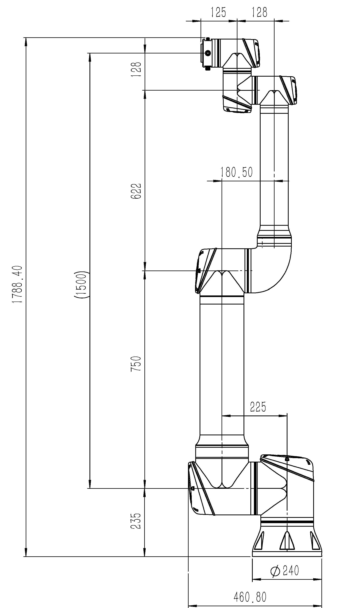
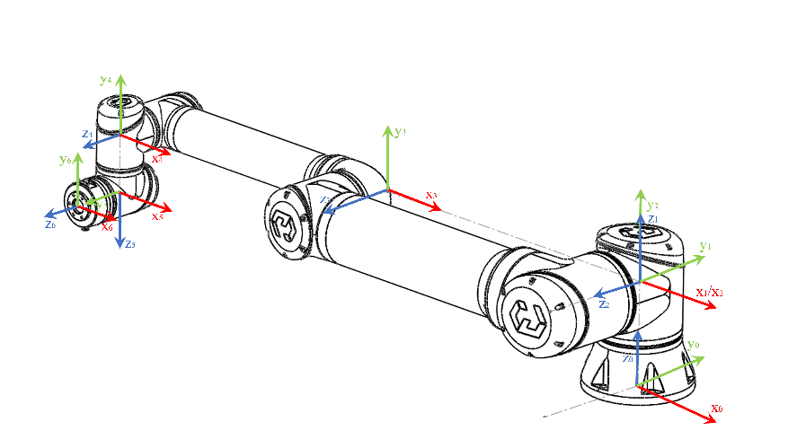
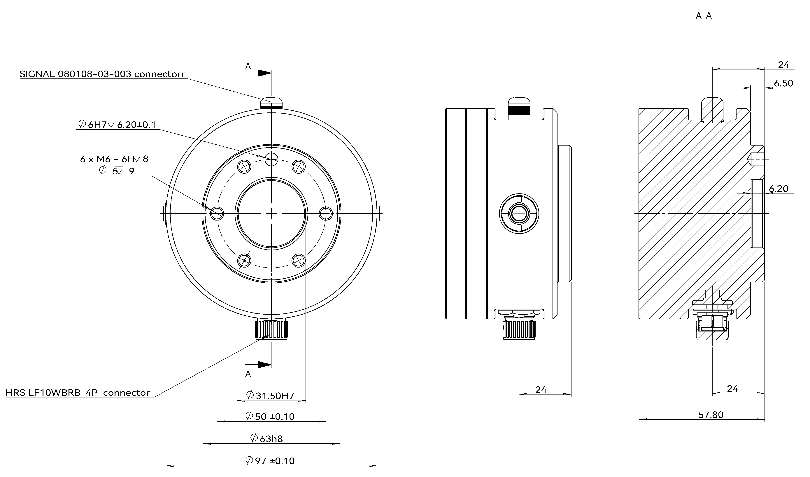
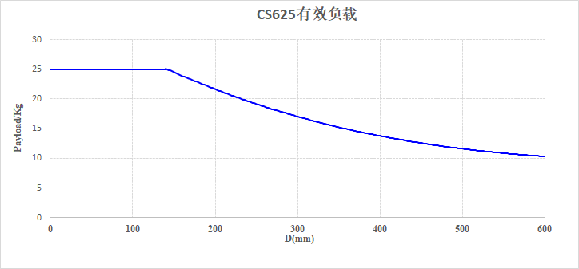
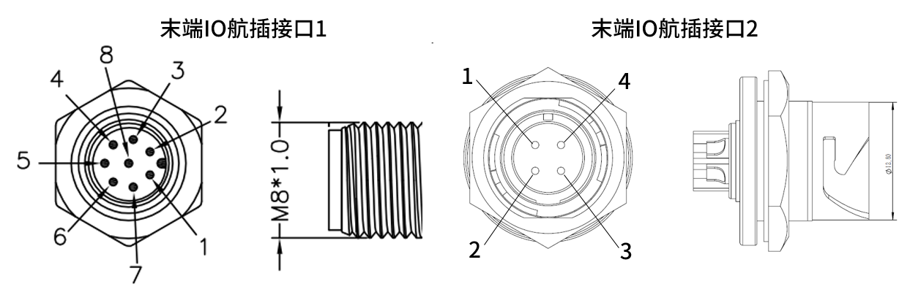
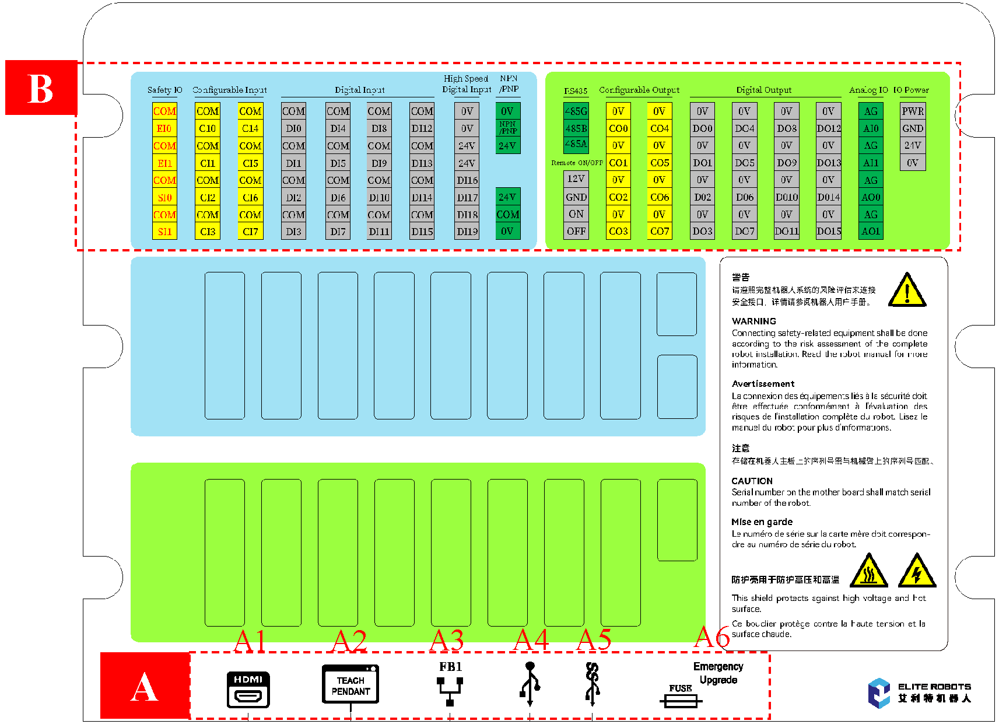
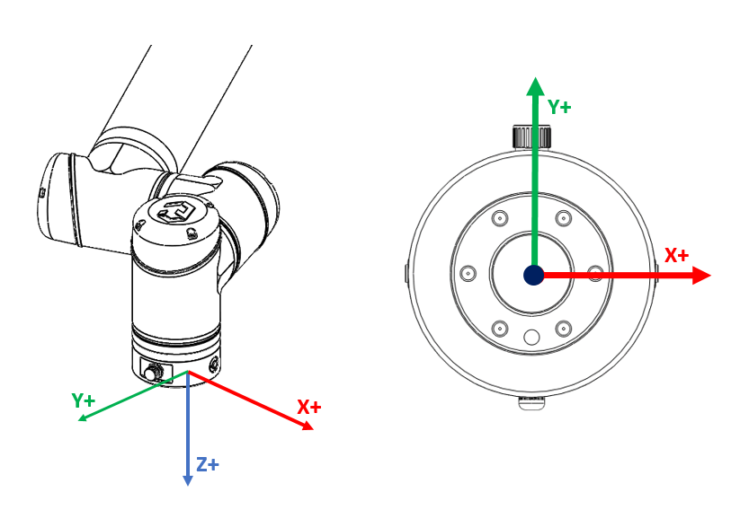

# 艾利特 CS625 协作机械臂用户手册核心工程参数与开发指引

> **文档来源**：`CS_用户手册_CS625_B1_Ver2.16.1.pdf`（艾利特智能机器人股份有限公司，2026-08-07 版本：Ver2.16.1）  
> **整理目的**：提取手册中与课题开发（主动感知、MoveIt 运动规划、ROS 2 Jazzy 驱动对接、末端工具/相机集成、力控装配与真机安全防护）强相关的物理参数、协议端口、电气定义与操作避坑要点，剔除通用的宣传与冗余说明，作为单一权威事实源归档。

---

## 1. 机械本体极限与运动学规格

### 1.1 基本物理指标与极限速度
用于 MoveIt `joint_limits.yaml`、仿真控制器速度上限及轨迹规划安全性校验：

| 参数项 | 官方指标值 | 工程含义与开发约束 |
|---|---|---|
| **额定有效负载** | 25 kg | 针对重心偏心距 $D \le 140\text{ mm}$ 的工况；偏心超出后需按降额曲线设计 |
| **最大工作半径** | 1500 mm | 最大理论可达包络半径（推荐工作范围直径 2744 mm） |
| **重复定位精度** | $\pm 0.05\text{ mm}$ (50 $\mu\text{m}$) | 本体机械重复精度极高；抓取与装配误差主要来自视觉估计、标定漂移与夹持刚度 |
| **自由度** | 6 自由度 | 关节 1 至关节 6 |
| **全关节运动范围** | $\pm 360^\circ$ | 物理可多圈转动，但真机受外部线缆束缚需在 URDF/规划器中严限范围 |
| **Joint 1 最大速度** | $125^\circ/\text{s}$ ($2.18\text{ rad/s}$) | 基座回转 |
| **Joint 2 最大速度** | $125^\circ/\text{s}$ ($2.18\text{ rad/s}$) | 大臂俯仰 |
| **Joint 3 最大速度** | $150^\circ/\text{s}$ ($2.62\text{ rad/s}$) | 肘部摆动 |
| **Joint 4 最大速度** | $180^\circ/\text{s}$ ($3.14\text{ rad/s}$) | 腕部俯仰（J4 抱闸受损关节，日常运行需严格降速） |
| **Joint 5 最大速度** | $180^\circ/\text{s}$ ($3.14\text{ rad/s}$) | 腕部偏摆 |
| **Joint 6 最大速度** | $180^\circ/\text{s}$ ($3.14\text{ rad/s}$) | 末端法兰回转 |
| **TCP 最大合成速度**| $3.3\text{ m/s}$ | 笛卡尔空间理论最大末端线速度 |
| **机械臂本体重量** | 58 kg | 控制柜 15 kg，示教器 0.96 kg |
| **防护等级** | 本体 IP68 / 控制柜 IP44 | 控制柜需防尘防潮 |

  
   <em>图 1-1：CS625 机械臂整体结构与各连杆尺寸（手册图 2-1）</em>

### 1.2 标准 DH 参数（用于校核 URDF / 运动学求解器）
手册第 2.1.1 节（表 2-1）给出的官方标准 DH 参数：

| 关节 Joint | $\theta\text{ [rad]}$ | $a\text{ [m]}$ | $d\text{ [m]}$ | $\alpha\text{ [rad]}$ | 结构对应段 |
|---|---|---|---|---|---|
| **Joint 1** | 0 | 0 | 0.235 | 0 | 基座高度 $h = 235\text{ mm}$ |
| **Joint 2** | 0 | 0 | 0 | $\pi/2$ | 肩部偏置 |
| **Joint 3** | 0 | -0.750 | 0 | 0 | 大臂长度 $L_1 = 750\text{ mm}$ |
| **Joint 4** | 0 | -0.622 | 0.1725 | 0 | 小臂长度 $L_2 = 622\text{ mm}$，腕偏置 $172.5\text{ mm}$ |
| **Joint 5** | 0 | 0 | 0.128 | $\pi/2$ | 腕关节 2 偏置 $128\text{ mm}$ |
| **Joint 6** | 0 | 0 | 0.125 | $-\pi/2$ | 法兰末端偏置 $125\text{ mm}$ |

  
   <em>图 1-2：CS625 标准 DH 坐标系建立示意图（手册图 2-3）</em>

---

## 2. 末端工具法兰、电气与布线红线

### 2.1 机械连接与结构防损死线
- **末端工具固定**：采用 6 个 M6 螺纹孔（分布圆直径 $\varnothing 50\text{ mm}$，销钉孔 $\varnothing 6\text{ mm}$，深 $6.2\text{ mm}$），推荐紧固扭矩 $8\text{ Nm}$（8.8级螺钉）。
- **严重损坏红线**：**固定工具的 M6 螺钉旋入深度严禁超过 8 mm**。若螺钉过长强行拧入，将直接穿透并报废工具法兰内部构件，导致必须整套更换法兰。
- **负载偏心降额关系**：
  - 工具与负载质心距法兰中心距离 $D \le 140\text{ mm}$ 时，最大允许负载为 $25\text{ kg}$；
  - $D = 300\text{ mm}$ 时，允许有效负载降为 $17\text{ kg}$；
  - $D = 400\text{ mm}$ 时，允许有效负载降为 $13\text{ kg}$；
  - $D = 600\text{ mm}$ 时，允许有效负载降为 $10\text{ kg}$。
  - 装配 Percipio 相机加电动夹爪时，必须在示教器或驱动中准确配置包含相机支架的总偏心距与总质心，避免动力学补偿错误引发伺服抖动或超差停机。

  
   <em>图 2-1：末端工具法兰安装机械尺寸（手册图 2-5，特别注意 M6 旋入深度严格 ≤ 8 mm）</em>

  
   <em>图 2-2：负载质量随偏心距离 D 衰减曲线（手册图 2-7）</em>

### 2.2 末端法兰电气接口（航插 1 与航插 2）
末端法兰自带两个连接器，用于就近为相机与末端执行器供电及通信：

  
   <em>图 2-3：末端航插接口 1（M8 8 芯）与航插接口 2（4 芯）引脚排布（手册图 2-42）</em>

#### 航插 1（M8 8 芯航插：信号与逻辑电源）
- **引脚分配与对应线色**：
  - Pin 1 (红): `AI2 / RS485+`（模拟输入 2 或 RS485 差分 A）
  - Pin 2 (黑): `AO2 / RS485-`（模拟输出 2 或 RS485 差分 B）
  - Pin 3 (橙): `TI3 / TO3 / PWR2`（数字输入/输出 3，或多针电源供电端 2）
  - Pin 4 (黄): `TI2 / TO2 / GND2`（数字输入/输出 2，或多针接地端 2）
  - Pin 5 (棕): `POWER`（主供电，支持示教器切换 0V / 12V / 24V）
  - Pin 6 (白): `TI0 / TO0 / GND1`（数字输入/输出 0，或多针接地端 1）
  - Pin 7 (绿): `TI1 / TO1 / PWR1`（数字输入/输出 1，或多针供电端 1）
  - Pin 8 (蓝): `GND`（主地线）
- **供电模式**：
  - 单针模式：仅用 Pin 5 供电，最大持续电流 $1000\text{ mA}$，峰值 $2000\text{ mA}$；
  - 双针模式：并联 Pin 5 与 Pin 3（或 Pin 7），最大持续电流 $2000\text{ mA}$；
  - 三针模式：并联 Pin 5、3、7，最大持续电流 $3000\text{ mA}$。
- **RS485 通信模式（TCI）**：
  - 示教器开启 USART/RS485 后，Pin 1 与 Pin 2 转为差分串口通信，**此时模拟输入 AI2 与 AO2 被硬件禁用**；
  - 可设置为 Daemon 模式，系统将挂载 `/dev/ttyTCI0` Linux 设备节点，供用户程序直接读写；
  - 控制器底层数据发送与接收各存在 $2\sim 4\text{ ms}$ 的固有总线缓冲延迟。

#### 航插 2（4 芯动力供电接口：高功率末端专用）
- **引脚分配**：Pin 1 为 24VDC，Pin 2 为 GND，Pin 3/4 为 CAN 预留（当前固件暂不支持）。
- **额定输出**：固定 24VDC 输出，最大支持 $5\text{ A}$（120W）持续供电。
- **电气禁忌**：航插 2 接容性负载时**严禁热插拔**，否则瞬态冲击电流会损坏末端电源板。

### 2.3 末端法兰实体按钮与状态灯
- 法兰两侧对称设有蓝色与绿色两颗实体按钮，可由用户自定义：
  - 长按：配置为自由拖动（Free-drive）或无动作；
  - 双击：配置为切换自由拖动状态、解除保护性停止（Protective Stop）或无动作。
- 末端环形灯带状态辨别：
  - 绿色常亮：正常运行模式；
  - 绿色快闪：任务暂停中；
  - 绿色慢闪：任务停止中；
  - 蓝色常亮：自由拖动示教模式；
  - 黄色常亮：保护性停止触发（Protective Stop）；
  - 红色常亮：紧急停机触发（Emergency Stop）。

---

## 3. 安全架构、停机机制与硬件保护

### 3.1 三类停机定义与系统响应（IEC 60204-1）
| 停机类别 | 动作行为 | 电源与抱闸状态 | 典型触发场景 |
|---|---|---|---|
| **0 类停机** | 非受控急停，执行器断电并依靠机械抱闸制动 | 立即切断电机动力电源，抱闸立即闭合 | 急停电路断开、内部严重通讯故障、运动超限、强制停机 |
| **1 类停机** | 受控减速制动，停止后切断电源并合闸 | 减速期间电机受控带电制动，静止后切断动力供电并闭合抱闸 | 示教器急停按钮按下、外接急停信号输入、正常程序 Stop 指令 |
| **2 类停机** | 受控减速制动并保持在轨迹上，**不切断动力** | 电机保持通电伺服状态，抱闸不闭合，维持刚度与位姿 | 安全防护停止（门禁/光幕）、安全平面越界、关节限位接近、碰撞检测告警 |

### 3.2 抱闸使用守则与防损边界（针对 J4 事故的预防）
1. **频繁通断电限制**：每个关节均内置机械摩擦制动器（抱闸）。**禁止频繁开断主电源，两次开关机时间间隔必须大于 10 秒**，避免浪涌及制动器动作磨损。
2. **断电强制外力移动上限**：在断电或未使能状态下，若要强行推动机械臂关节，需要施加**至少 700 N** 的巨大外力。此方式仅限人员受困等极端救援，日常调试严禁强推，极易造成减速机轮齿崩裂或抱闸偏位。
3. **抱闸释放微动现象**：上电释放抱闸时，电机会经历预励磁与伺服使能闭环，伴随轻微响声与亚毫米级物理下沉/跳动，属于电机控制正常物理过渡。

### 3.3 关节自动标定功能与震荡抑制
- **现象真因**：示教器系统默认开启「关节自动标定」。当控制器检测到某个关节的绝对编码器与上一记忆状态存在非精确微差时，释放抱闸瞬间会自动执行微幅回正运动。
- **抑震设置**：在插槽插入等 1~2 mm 紧密装配间隙场景下，微动极易引发碰撞。可在示教器前往「设置」>「通用配置」，**取消勾选「关节自动标定」**。关闭后改为由操作人员在开阔安全位手动点击状态栏的标定按钮，防止工件在狭小空间内因释闸微动而别死。

---

## 4. 通信接口与上位机开发协议

### 4.1 网络拓扑与端口分配
控制柜主板自带 **FB1 千兆网口**，外部上位机（ROS 2 主机）通过该口与机器人通信：

| 端口号 | 协议名称 | 数据传输特征 | 在本工程中的角色与作用 |
|---|---|---|---|
| **29999** | **Dashboard Shell** | TCP 文本协议，ASCII 字符交互，每条命令须以 `\n` 结尾 | 用于远程控制上电、释放抱闸、加载任务、清除报警、查询机器人运行模式与状态 |
| **30001** | **Primary Interface** | TCP 二进制状态报文，固定 **10 Hz** 广播；支持发送 Python 语法脚本 (`def ... end`) | 采集主板状态、机器人模式数据包；运行单次脱机脚本 |
| **30004** | **RTSI 实时同步接口** | TCP 二进制交互协议，基于版本协商与数据项动态订阅 | **ROS 2 官方驱动的核心链路**：高频双向同步关节角度、关节速度、TCP 实时力矩、IO 状态 |
| **502** | **Modbus TCP** | 工业标准协议，支持 Server 与 Client 模式 | 扩展 PLC、外部传送带光电开关或工业夹爪通信 |

  
   <em>图 4-1：控制柜内部电气接口分布图（手册图 2-13，包含 A 区网口/USB 与 B 区安全/通用 I/O）</em>

> **网络配置避坑**：若控制柜启用了 Profinet 通信功能，系统会**强制锁定以太网设置**。如需修改 IP 或网关，必须先前往「配置」>「通讯」>「Profinet」点击禁用后方可修改。

### 4.2 远程控制使能条件（Remote Control）
- 控制器严格区分「本地模式」与「远程控制模式」。
- **必须在示教器前往「系统」>「设置」>「远程控制」，勾选启用「远程模式」**。在本地模式下，上位机通过以太网发送的任何运动控制指令（包括 29999/30001/30004 的运动请求）都将被控制器内核直接丢弃或拒绝。

---

## 5. 坐标系、力控与高级任务配置

### 5.1 默认末端工具坐标系（Tool Flange Frame）方向
- 官方规定法兰出线口/电气航插朝向为 **-Y 轴**；
- 垂直于法兰安装面指向外侧为 **+Z 轴**；
- 定位销孔中心位于 **-Y 轴** 方向；
- 欧拉角遵循 RPY 格式（Roll-Pitch-Yaw，外旋或固定轴旋转表示法），示教器支持弧度 `rad` 与角度 `°` 切换。

  
   <em>图 5-1：官方末端法兰坐标系定义与出线口关系（手册图 3-44）</em>

### 5.2 力控功能与参数配置（课题精密插拔装配参考）
手册第 3.6.6 节介绍了控制器内置力控功能，在开发高层装配策略时可作基准对照：
1. **四种力控坐标系模式**：
   - 固定模式：力控轴固定在基座或用户自定义台面坐标系（适用于平面打磨、直插）；
   - TCP 模式：力控轴随末端工具姿态实时旋转（适用于沿工件轴向进给）；
   - 点模式：以工具中心指向参考点的连线为特征轴；
   - 运动模式：力控坐标系随 TCP 实时运动速度方向动态投影。
2. **力控保护与动态参数**：
   - 碰撞力阈值（Collision Threshold）：数值范围 `[0, 250] N`，超过后触发 2 类受控停机；
   - 阻尼配置：平动阻尼与旋转阻尼以百分比调节，阻尼越大运动越平稳但响应滞后；
   - 脚本接口：在控制脚本中可通过 `get_tcp_force()` 读取当前传感器计算得到的实时三维力与力矩矢量；
   - 模式切换延时：进入力控模式前推荐插入至少 `0.02 s` 的 `sleep` 延时，避免运动加速度瞬态引发力控超调。
